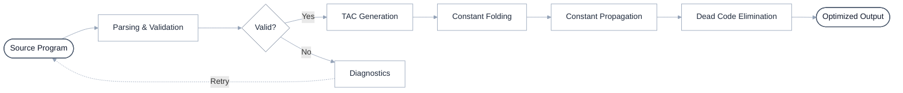
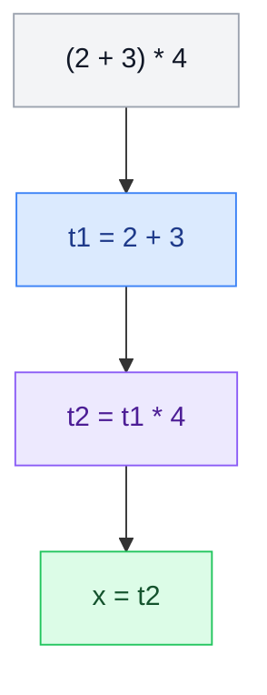

# ⚡ OPTIMORPH

> ###  An Interactive Compiler Optimization Playground

Explore compiler internals through an interactive Java desktop application. Parse a small arithmetic language, generate Three-Address Code (TAC), experiment with optimization techniques, and inspect diagnostics through a clean Swing interface.

<p align="center">

  **Java 21** · **Maven** · **Java Swing** · **JUnit 5**

</p>

---

## 📌 Overview

MiniJava Optimization Lab is an educational compiler project designed to demonstrate fundamental compiler concepts through a visual, hands-on workflow.

| Capability | Description |
|---|---|
| Interactive UI | Edit source code and inspect each processing stage |
| Parsing | Validate and process arithmetic assignments |
| TAC Generation | Convert expressions into simple intermediate instructions |
| Constant Folding | Evaluate constant arithmetic expressions |
| Constant Propagation | Substitute known constant values into expressions |
| Dead-Code Elimination | Remove assignments considered unnecessary |
| Diagnostics | Report syntax errors, undefined variables, and basic division-by-zero warnings |
| Unit Testing | Verify core parsing and optimization behavior with JUnit |

> **Scope:** This is a learning-oriented compiler lab for a small arithmetic assignment language. It is not a complete Java compiler or an implementation of Java value types.

## 🏗️ Compiler Architecture

The workflow illustrates source validation, intermediate code generation, and successive optimization stages.



*Note: The diagram represents the overall workflow. In the current implementation, TAC is generated separately from the existing expression-based optimization stages.*

## 🔄 How Optimization Works

Consider this source program:

```text
a = 10 + 20;
b = a * 2;
unused = 5 * 0;
result = b + 1;
```

### Processing stages

| Stage | Purpose | Example transformation |
|---|---|---|
| Source | Original arithmetic assignments | `a = 10 + 20;` |
| TAC | Break expressions into instructions | `t1 = 10 + 20` |
| Folding | Evaluate constant expressions | `a = 30` |
| Propagation | Reuse known constant values | `b = 60` |
| Dead-code elimination | Remove unused assignments | Remove `unused` when safe under the current model |

### Example: Three-Address Code

Input:

```text
x = (2 + 3) * 4;
```

Generated TAC:

```text
t1 = 2 + 3
t2 = t1 * 4
x = t2
```



Temporary variables such as `t1` and `t2` make individual operations easier to inspect.

## 🖥️ Application Interface

The desktop application provides a source editor, diagnostics panel, and separate output tabs.

| Interface section | What it displays |
|---|---|
| Source Program | Editable arithmetic assignments |
| Diagnostics | Line-numbered errors and warnings |
| Parsed | Parsed assignment representation |
| TAC Generation | Generated intermediate instructions |
| Constant Folding | Expressions simplified using constants |
| Constant Propagation | Expressions after constant substitution |
| Dead Code Elimination | Remaining assignments after dead-code removal |

## 🛠️ Technology Stack

| Technology | Purpose |
|---|---|
| Java 21 | Core implementation |
| Java Swing | Desktop graphical interface |
| Apache Maven | Build and dependency management |
| JUnit 5 | Unit testing |
| Regular Expressions | Token recognition and basic validation |
| Expression Parsing | Infix-to-postfix conversion and evaluation |

## 🚀 Getting Started

### Prerequisites

- Java Development Kit (JDK) 21
- Apache Maven 3.9 or a compatible version
- Git (optional)

Verify your installations:

```powershell
java -version
mvn -version
```

### 1. Clone the repository

```bash
git clone <YOUR_REPOSITORY_URL>
cd <YOUR_REPOSITORY_FOLDER>
```

Replace the placeholders with your actual repository URL and folder name.

### 2. Run the test suite

```powershell
mvn clean test
```

### 3. Launch the application

```powershell
mvn compile exec:java
```

**Windows users:** If Maven is not configured in your `PATH`, use the full path to your Maven executable:

```powershell
& "C:\Users\ADMIN\.maven\apache-maven-3.9.16\bin\mvn.cmd" clean test

& "C:\Users\ADMIN\.maven\apache-maven-3.9.16\bin\mvn.cmd" compile exec:java
```

Adjust this path to match your local installation.

## 🧪 Diagnostics Examples

| Input | Expected result |
|---|---|
| `x = 10 + 5;` | Valid assignment |
| `x = y + 1;` | Undefined variable, if `y` has not been defined |
| `x = 10 + 2` | Missing semicolon |
| `x = 10 @ 2;` | Invalid expression character |
| `x = 10 / 0;` | Basic division-by-zero warning |

Diagnostics are educational checks, not a complete static-analysis system.

## 📚 Supported Language

The application implements a deliberately limited arithmetic assignment language.

| Feature | Supported syntax |
|---|---|
| Assignment | `result = expression;` |
| Integer literals | `10`, `250` |
| Identifiers | `value`, `_count`, `result2` |
| Operators | `+`, `-`, `*`, `/` |
| Grouping | `(10 + 5)` |
| Statement termination | `;` |

### Current limitations

- No full Java grammar, classes, methods, loops, or conditionals.
- No unary-minus support in the expression parser.
- Diagnostics cover common cases, not every possible semantic issue.
- Division-by-zero detection uses a basic heuristic.
- Dead-code elimination treats the final assignment as the observable result.
- TAC is an intermediate representation, not executable machine code.
- This project does not implement Java value types or generate native machine code.

## 📂 Project Structure

```text
MiniJava-Optimization-Lab/
├── src/
│   ├── main/
│   │   └── java/
│   │       └── edu/
│   │           └── compilerlab/
│   │               ├── Main.java
│   │               ├── CompilerLabUI.java
│   │               └── Pipeline.java
│   └── test/
│       └── java/
│           └── edu/
│               └── compilerlab/
│                   └── PipelineTest.java
├── pom.xml
└── README.md
```

## 🔮 Future Improvements

- Display instruction counts before and after optimization.
- Add detailed optimization traces.
- Expand unit and edge-case tests.
- Introduce an abstract syntax tree (AST).
- Add a dedicated intermediate representation for optimization passes.
- Explore control-flow graphs and more advanced optimizations.

## 🎯 Learning Objectives

Through this project, you can explore:

- The fundamentals of compiler pipelines.
- Expression parsing and operator precedence.
- Intermediate-code generation.
- Constant folding and propagation.
- Dead-code elimination.
- Error reporting and unit testing.

## 📄 License

No license has been specified yet. Add a `LICENSE` file if you intend to publish the project with explicit reuse and distribution permissions.

## 👩‍💻 Development Note

This is an educational learning project. Understand the implementation, test its behavior, and accurately describe which parts you implemented or modified. Do not represent AI-generated code as independently authored work when an application or evaluation prohibits AI-generated submissions.
